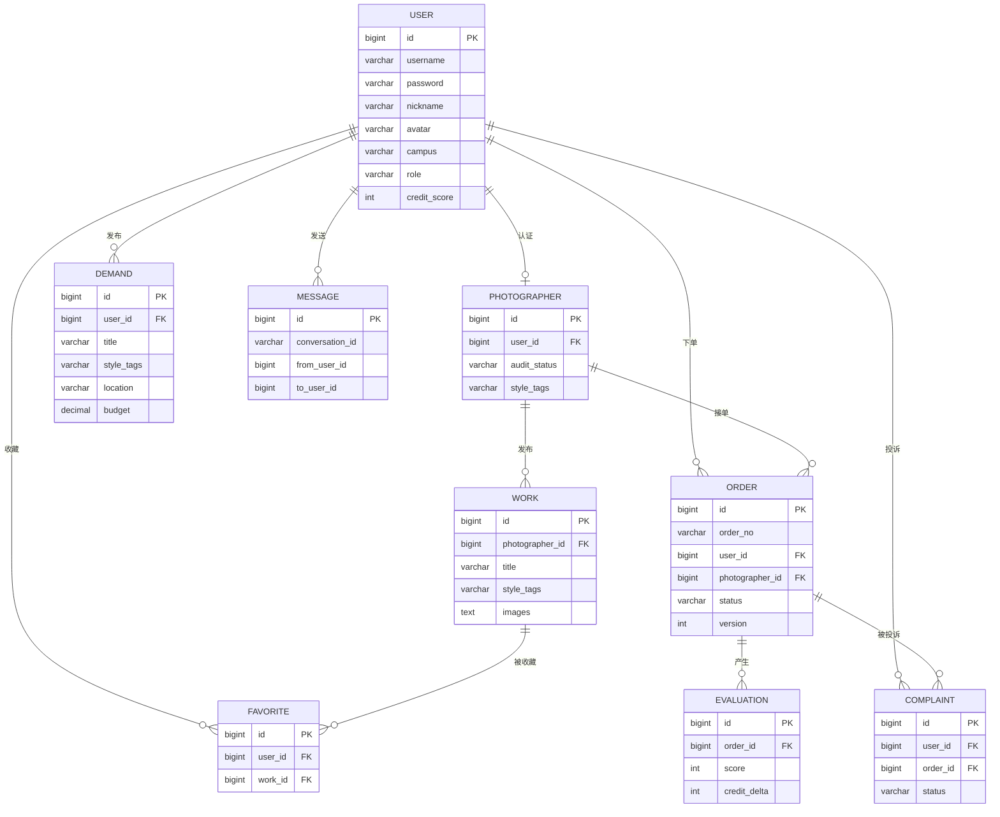
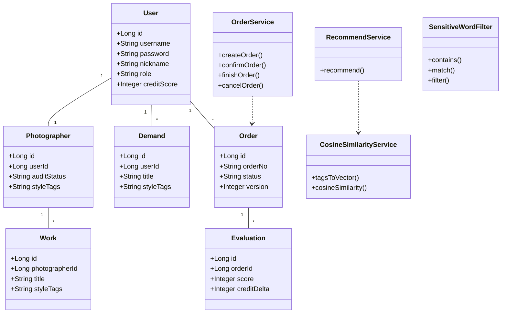
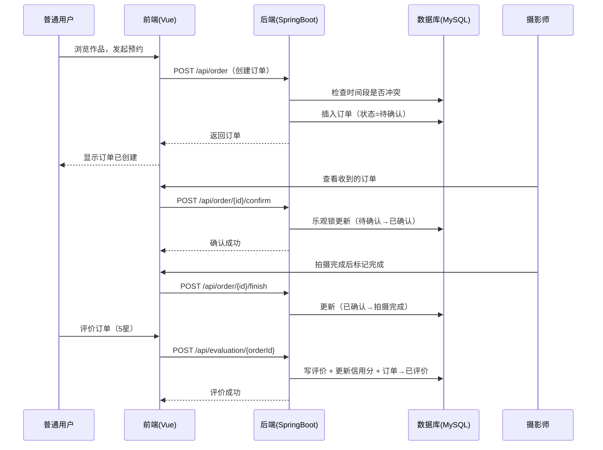

# 系统设计文档（建模）

本文档使用 Mermaid 语法描述校园约拍平台的需求建模与设计建模，包含用例图、ER 图、类图、顺序图，供论文"系统设计"章节参考。Mermaid 图可在支持 Mermaid 的工具（如 Typora、VS Code 插件、GitHub）中渲染。

## 一、需求建模

### 1.1 用例图

系统涉及三类角色：普通用户、认证摄影师、管理员。

```mermaid
graph TD
    subgraph 校园约拍平台
        U1[注册登录]
        U2[发布约拍需求]
        U3[浏览/搜索作品与需求]
        U4[收藏作品]
        U5[智能推荐匹配]
        U6[发起预约订单]
        U7[实时私信沟通]
        U8[订单评价]
        U9[申请摄影师认证]
        P1[发布管理作品集]
        P2[确认/拒绝订单]
        P3[订单状态更新]
        A1[审核摄影师认证]
        A2[用户管理]
        A3[内容审核与下架]
        A4[订单管理]
        A5[投诉仲裁]
        A6[数据统计看板]
    end

    U(普通用户) --> U1
    U --> U2
    U --> U3
    U --> U4
    U --> U5
    U --> U6
    U --> U7
    U --> U8
    U --> U9

    P(认证摄影师) --> P1
    P --> P2
    P --> P3

    A(管理员) --> A1
    A --> A2
    A --> A3
    A --> A4
    A --> A5
    A --> A6
```

## 二、数据建模

### 2.1 ER 图（实体关系）

核心实体及其关系：

## 三、架构设计

### 3.1 类图（核心类关系）

### 3.2 顺序图（预约订单核心流程）

## 四、接口设计

统一 RESTful 风格，前缀 `/api`，认证使用 `Authorization: Bearer <token>`。

| 模块 | 方法 | 路径 | 说明 |
|------|------|------|------|
| 认证 | POST | /api/auth/register | 注册 |
| 认证 | POST | /api/auth/login | 登录 |
| 用户 | GET/PUT | /api/user/me | 查看/修改个人信息 |
| 需求 | POST/GET/PUT/DELETE | /api/demand | 需求增删改查 |
| 作品 | POST/GET/PUT/DELETE | /api/work | 作品增删改查 |
| 推荐 | GET | /api/recommend/photographers | 智能推荐 |
| 收藏 | POST | /api/favorite/toggle/{workId} | 收藏/取消 |
| 订单 | POST | /api/order | 创建订单 |
| 订单 | POST | /api/order/{id}/confirm | 确认订单 |
| 评价 | POST | /api/evaluation/{orderId} | 评价 |
| 私信 | POST/GET | /api/message | 发送/查询私信 |
| 投诉 | POST | /api/complaint | 提交投诉 |
| 管理端 | GET/POST | /api/admin/** | 管理端接口 |
